<div align="center">

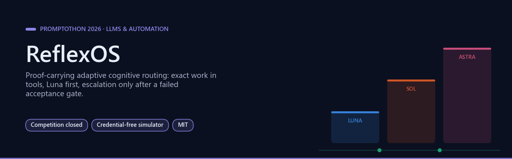

# ReflexOS — Proof-Carrying Adaptive Cognitive Routing

[](https://github.com/Agnuxo1/ReflexOS-Promptothon-2026/actions/workflows/tests.yml) [](LICENSE)  [](docs/CLOSURE.md) [](#reproducible-benchmark) [](https://www.kaggle.com/competitions/promptothon-2026-ai-edition)

[**Problem**](#the-problem) · [**Architecture**](#architecture) · [**Benchmark**](#reproducible-benchmark) · [**Quick start**](#quick-start) · [**Limitations**](#honest-limitations) · [**Closure evidence**](docs/CLOSURE.md) · [**Writeup**](KAGGLE_WRITEUP.md) · [**Demo script**](DEMO_SCRIPT.md)

</div>

**Promptothon 2026 · LLMs & Automation**

**Competition closed.** The official Kaggle API deadline is **23 September 2026,
18:30 UTC (20:30 Madrid)**. This repository is retained as the project archive;
no new competition entry is being attempted. The 28 October API check returns
zero standard submission rows, which does not establish whether a hackathon
Writeup was submitted. An accepted Writeup receipt, final judging result and
prize remain **unverified**. [Closure evidence](docs/CLOSURE.md).

> Use the smallest intelligence necessary — and prove when escalation is justified.

ReflexOS is a reproducible cognitive orchestration layer for AI agents. Instead of sending every task to the largest model, it executes exact work with deterministic tools, consults a bounded semantic router only when useful, starts every generative task on a low-cost **Luna** tier, and unlocks **Sol** or **Astra** only after observable acceptance-gate failure.

The project hybridizes three existing research lines by Francisco Angulo de Lafuente:

- **Universal Cognitive Architecture · JEV v2** — verified cache, explicit acceptance gates, bounded execution and factual checkpoints.
- **JEV Orchestrator v3** — Reflex Fabric, event-driven semantic checkpoints, LUNA-FIRST routing and evidence-gated escalation.
- **King-Skill v4** — deterministic skill routing and the principle that exact computation belongs in tools, not language-model tokens.

The competition project adds a clean provider abstraction, safe deterministic skills, a credential-free simulator, a reproducible policy benchmark, Gradio UX, CI tests, a public-notebook workflow and judge-facing documentation.

**Contents** — [The problem](#the-problem) · [Background](#background) · [Architecture](#architecture) · [Reproducible benchmark](#reproducible-benchmark) · [Quick start](#quick-start) · [Optional TypeSafe JEV integration](#optional-typesafe-jev-integration) · [Deterministic skills](#deterministic-skills) · [Acceptance checks](#acceptance-checks) · [Why this fits Promptothon 2026](#why-this-fits-promptothon-2026) · [Test evidence](#test-evidence) · [Repository layout](#repository-layout) · [Honest limitations](#honest-limitations) · [Real-world applications](#real-world-applications) · [Possible improvements](#possible-improvements) · [Proposed next steps (not commitments)](#proposed-next-steps-not-commitments) · [Competition source](#competition-source) · [License](#license) · [Bibliography](#bibliography)

## The problem

<p align="center">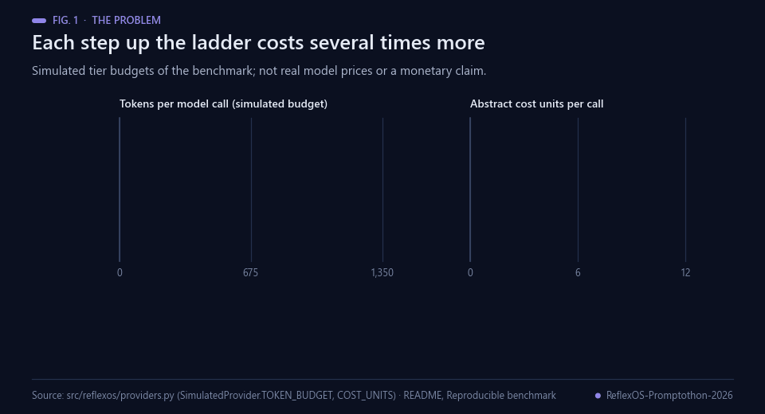<br><sub>Fig. 1 — Simulated tier budgets. Source: src/reflexos/providers.py.</sub></p>

Modern agent stacks often use a powerful model for tasks that do not need one. That creates unnecessary cost and latency, and it makes failures harder to audit. At the opposite extreme, blindly forcing every task through a cheap model can reduce quality.

ReflexOS treats model capability as a **budgeted resource**. Escalation is an explicit control-flow event backed by evidence: a failed deterministic acceptance check, uncertainty, risk, or conflicting evidence. Provider advice cannot bypass local budgets or verification.

## Background

<p align="center">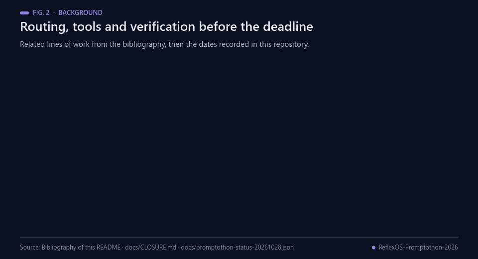<br><sub>Fig. 2 — Related work and the dates recorded in this repository. Sources: bibliography below, docs/CLOSURE.md.</sub></p>

Choosing which model should answer is an established cost-control problem. FrugalGPT describes cascades of language
models that stop at the first answer judged good enough [[1](#ref-1)]; RouteLLM and Hybrid LLM learn routers that send each
query to a stronger or a cheaper model [[2](#ref-2), [3](#ref-3)]; and language-model cascades treat chained models and tools as
probabilistic programs [[4](#ref-4)]. ReflexOS keeps the cascade idea but fixes the policy in code: Luna always goes
first, and a stronger tier is unlocked by an observable failure of a host-side check, not by a learned score.

Two further lines motivate the design. Exact computation can be handed to a program or a tool instead of being
generated token by token [[5](#ref-5), [6](#ref-6)], which is why hashing, counting and arithmetic run as deterministic skills
(arithmetic on an allow-list of Python AST nodes [[13](#ref-13)]). And outputs are better judged by something other than
the generator: trained verifiers and step-level checking improve selection of candidate solutions [[7](#ref-7), [8](#ref-8)],
while self-correction without external feedback is unreliable for reasoning [[9](#ref-9)]. That is the reason the acceptance
checks are evaluated by host code and a model never marks its own answer as correct. Concern about the compute
cost of AI is not new [[10](#ref-10), [11](#ref-11)]; the demonstration interface uses Gradio [[12](#ref-12)].

The project hybridizes three earlier research lines by Francisco Angulo de Lafuente: the Universal Cognitive
Architecture JEV v2 (public repository [[14](#ref-14)]), JEV Orchestrator v3 (no public repository is linked here) and the
King-Skill line, of which the README names v4 (public repository [[15](#ref-15)]). The competition deadline recorded in
this repository is 23 September 2026, 18:30 UTC; on 28 October 2026 the read-only API check reported zero standard
submission rows, and the repository is retained as an archive.

## Architecture

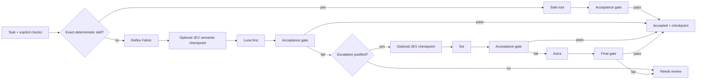

<p align="center">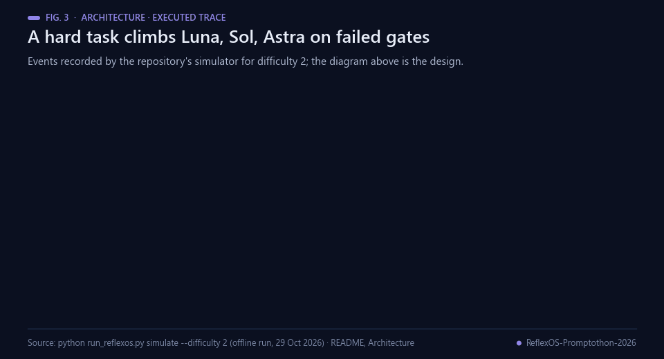<br><sub>Fig. 3 — Executed trace of the simulator for difficulty 2 (the diagram above is the design).</sub></p>

### Invariants

<p align="center">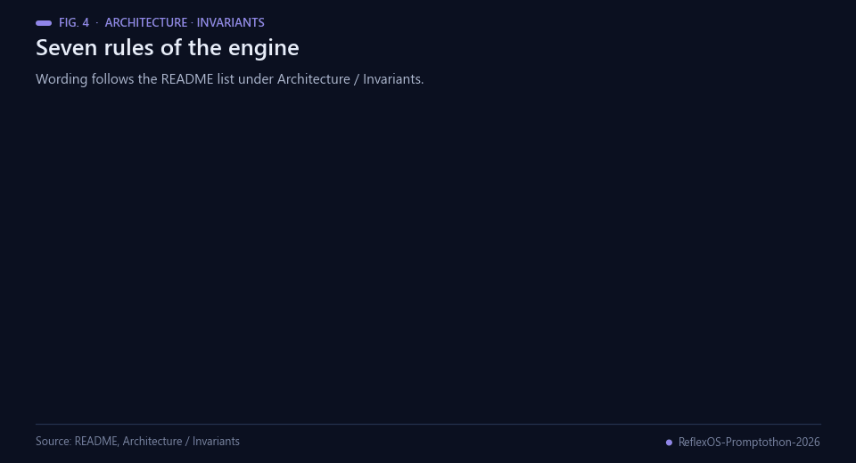<br><sub>Fig. 4 — The seven invariants, as worded in the list below.</sub></p>

1. Deterministic work is attempted before any LLM.
2. Luna is always the first generative tier.
3. Sol and Astra are reachable only after a failed acceptance gate and the local Reflex Fabric allows escalation.
4. JEV may advise semantic routing, uncertainty and review shape, but it cannot override budgets, safety or checks.
5. A JEV outage falls back to a conservative local router instead of blocking the workflow.
6. Only verified deterministic outputs are cached.
7. Run checkpoints contain factual telemetry, not hidden reasoning or credentials.

## Reproducible benchmark

<p align="center">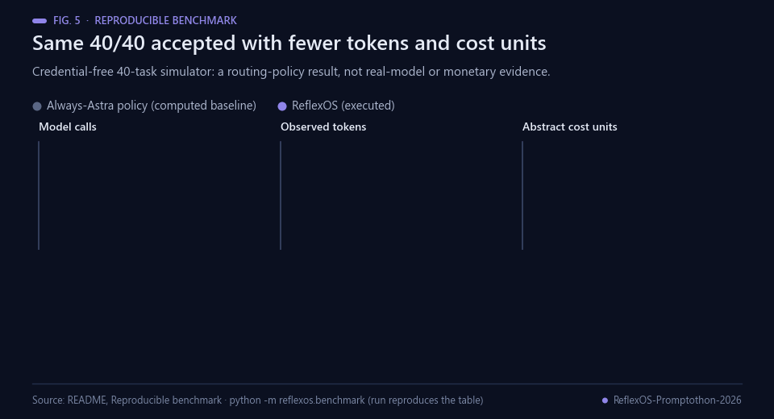<br><sub>Fig. 5 — The published table, drawn. Simulator result, not real-model or monetary evidence; the always-Astra baseline is computed, not executed.</sub></p>

Run:

```bash
python -m reflexos.benchmark
```

Current reference result on the included 40-task synthetic policy suite:

| Metric | Always-Astra policy | ReflexOS |
|---|---:|---:|
| Accepted tasks | 40/40 | 40/40 |
| Model calls | 40 | 37 |
| Observed tokens | 54,000 | 15,830 |
| Abstract cost units | 480 | 100 |
| Token reduction | — | **70.69%** |
| Cost-unit reduction | — | **79.17%** |

The suite contains 16 deterministic tasks, 14 easy generative tasks, 7 medium tasks and 3 hard tasks. The simulated provider assigns transparent capabilities and token/cost budgets to Luna, Sol and Astra. **This benchmark validates routing policy behavior; it is not evidence that one real frontier model is better than another, nor is it a monetary cost claim.**

<p align="center">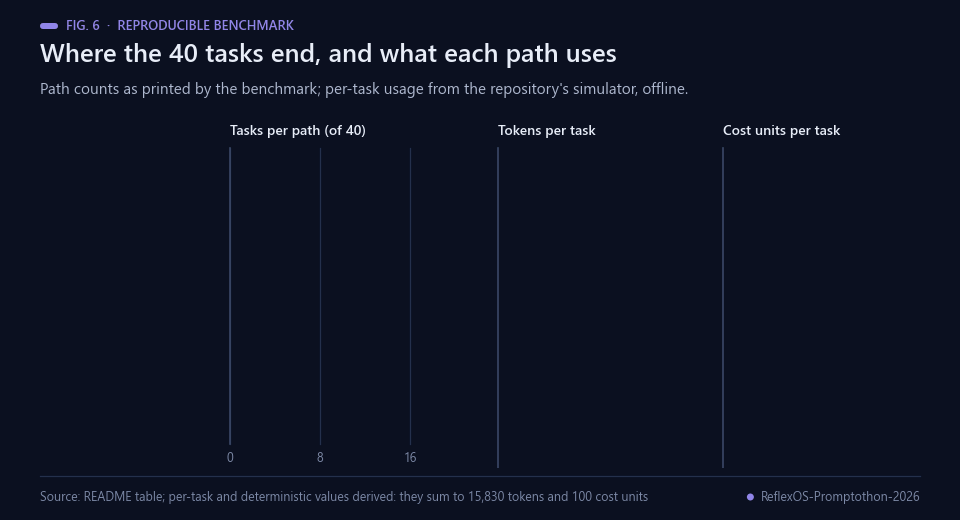<br><sub>Fig. 6 — Path counts from the benchmark; per-task usage from the repository's own simulator.</sub></p>

Observed ReflexOS paths are deterministic by construction:

```text
16 × deterministic
14 × luna
 7 × luna -> sol
 3 × luna -> sol -> astra
```

## Quick start

<p align="center">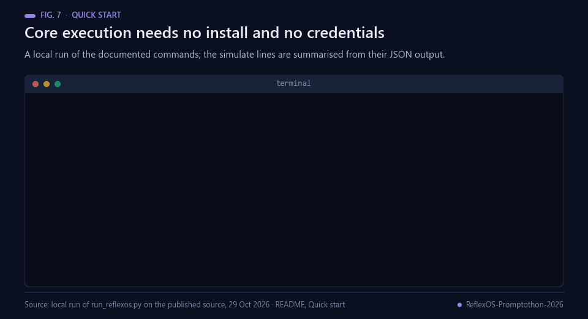<br><sub>Fig. 7 — A local run of the documented commands; the simulate lines are summarised from their JSON output.</sub></p>

Core execution has no third-party runtime dependency and does not require package installation.

```bash
python run_reflexos.py benchmark
python run_reflexos.py simulate --difficulty 0
python run_reflexos.py simulate --difficulty 1
python run_reflexos.py simulate --difficulty 2
```

On Windows, the same commands are available through `run.bat`, for example `run.bat benchmark`. An editable package installation is optional (`python -m pip install -e .`).

For the web demo, install Gradio once and launch the app directly:

```bash
python -m pip install "gradio>=5,<7"
python app.py
```

For development:

```bash
python -m pip install -e ".[dev]"
pytest
```

## Optional TypeSafe JEV integration

<p align="center">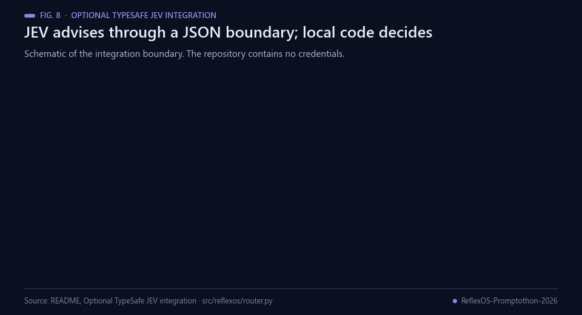<br><sub>Fig. 8 — Schematic of the integration boundary; JEV advice never changes Luna-first or the checks.</sub></p>

The repository contains no credentials. `JEVSubprocessRouter` connects to an existing JEV installation through its public JSON subprocess contract. The external connector remains responsible for authentication.

```python
from reflexos import Engine, JEVSubprocessRouter, SimulatedProvider

router = JEVSubprocessRouter(
    connector=[r"C:\path\to\python.exe", "-m", "jev_orchestrator.connection"],
    cwd=r"C:\path\to\JEV-Orchestrator",
)
engine = Engine(SimulatedProvider(), semantic_router=router)
```

If JEV is unavailable, the engine records the failure and uses `LocalSemanticRouter`; LUNA-FIRST and local verification remain unchanged.

## Deterministic skills

<p align="center">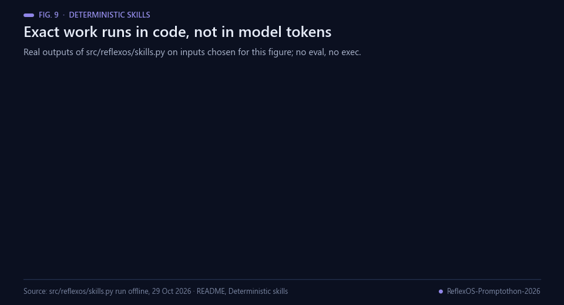<br><sub>Fig. 9 — Real outputs of src/reflexos/skills.py on inputs chosen for this figure.</sub></p>

The current public prototype includes:

- SHA-256 hashing
- UTF-8-aware text statistics
- canonical JSON summary/fingerprint
- safe arithmetic using a strict Python AST allowlist — no `eval`, no `exec`

These are intentionally small, inspectable examples. The architecture is designed for additional typed tools without weakening the model-routing invariant.

## Acceptance checks

<p align="center">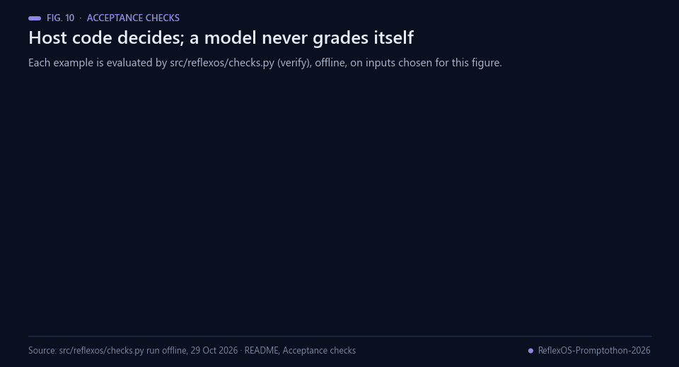<br><sub>Fig. 10 — Each example is evaluated by the repository's own verify function.</sub></p>

- `nonempty`
- `contains`
- `excludes`
- `json_equals`
- `numeric_range`

Checks are evaluated by host code. A model never marks its own answer as correct.

## Why this fits Promptothon 2026

<p align="center">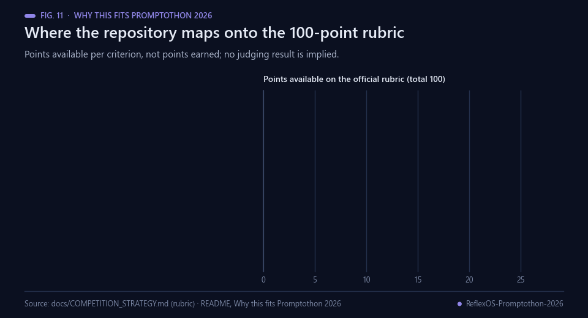<br><sub>Fig. 11 — Points available per criterion (docs/COMPETITION_STRATEGY.md), not points earned.</sub></p>

The official Promptothon rubric emphasizes technical implementation, innovation, effective AI use, impact, UX and scalability. ReflexOS maps directly to those criteria without requiring a GPU-heavy training run:

| Rubric area | Demonstrable evidence in this repository |
|---|---|
| Innovation & Originality | Proof-carrying escalation; deterministic Reflex Fabric around semantic routing |
| Technical Implementation | Typed contracts, hard budgets, integrity-checked cache, safe skills, fallbacks, CI and tests |
| Effective Use of AI | Optional TypeSafe JEV semantic decisions plus tiered LLM execution only where useful |
| Relevance & Impact | Reduces waste, cost and latency in agent workflows while preserving explicit quality gates |
| UX & Usability | Gradio route inspector and one-click reproducible benchmark |
| Scalability & Feasibility | Provider/router interfaces, credential separation, no accelerator required for core orchestration |

## Test evidence

<p align="center">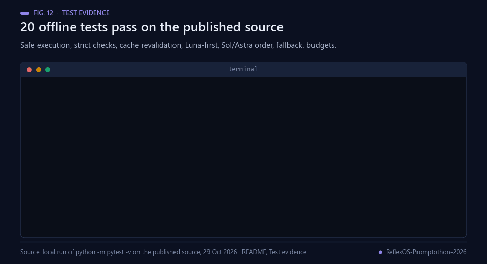<br><sub>Fig. 12 — A real local run of the offline test suite on the published source.</sub></p>

The repository currently passes **20/20** automated tests covering:

- safe deterministic execution and code-injection rejection
- strict acceptance checks
- cache revalidation
- mandatory Luna-first behavior
- Sol/Astra ordering after failed gates
- JEV-router failure fallback
- critical-risk human checkpoint
- hard model-call budgets
- deterministic benchmark paths and savings

Run the same gate in CI with Python 3.11 and 3.12.

## Repository layout

<p align="center">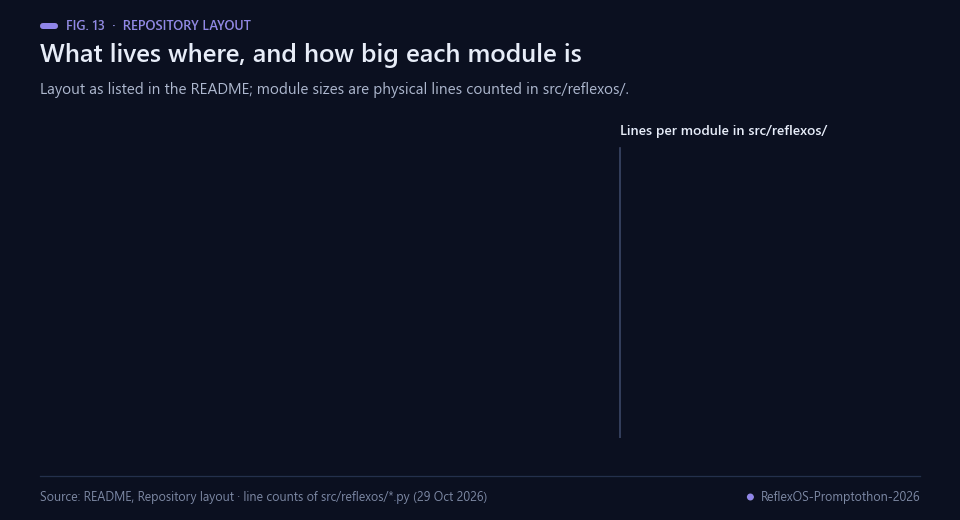<br><sub>Fig. 13 — Layout from the README; module sizes counted from the source files.</sub></p>

```text
src/reflexos/       Core engine, Reflex Fabric, routing, providers, skills, cache
app.py              Gradio demonstration
notebooks/          Kaggle/Jupyter public demonstration notebook
tests/              Automated regression tests
docs/               Competition analysis and evidence
KAGGLE_WRITEUP.md   Submission-ready writeup
DEMO_SCRIPT.md      <=3-minute judge demo script
```

## Honest limitations

<p align="center">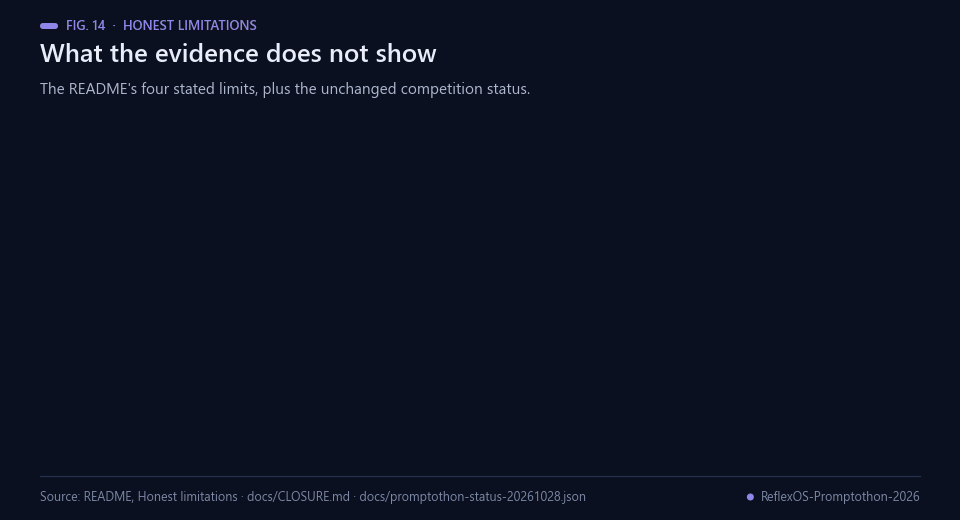<br><sub>Fig. 14 — The four stated limits and the status recorded in docs/CLOSURE.md.</sub></p>

- The included benchmark is synthetic and intentionally isolates routing policy; real-provider quality/cost evaluation is a separate experiment.
- Semantic routing is advisory. Passing a simple string or JSON check does not prove factual truth.
- The public prototype does not embed provider credentials or assume access to any proprietary model tier.
- Current public Promptothon pages expose no competitor writeups or notebooks, so this repository does not fabricate strategies for other teams.

## Real-world applications

<p align="center">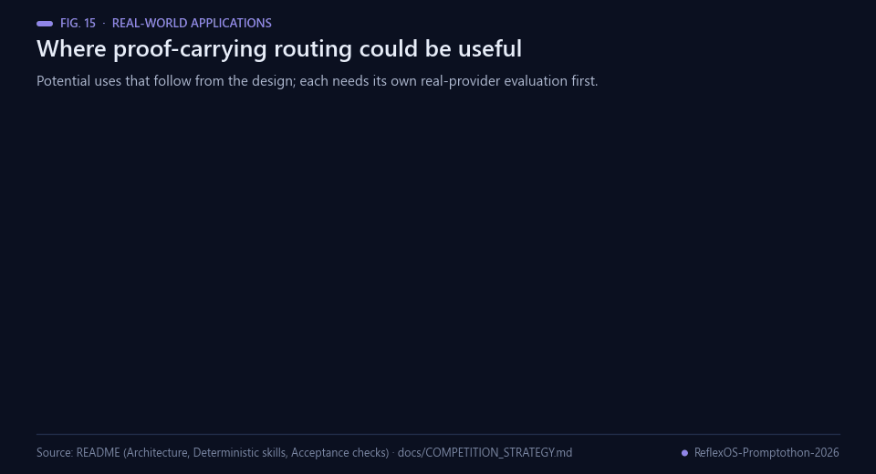<br><sub>Fig. 15 — Potential uses that follow from the design; none has been evaluated with a real provider.</sub></p>

The following are potential uses that follow from the architecture; each would first need the real-provider
evaluation named under Honest limitations.

- **Agent cost control.** Start routine agent steps on a low-cost tier and pay for a stronger model only when a
  check fails, in the spirit of model cascades [[1](#ref-1)].
- **Auditable escalation.** Keep a factual event log of why each stronger tier was used, instead of an opaque
  routing score.
- **Tool-first pipelines.** Keep hashing, counting and arithmetic in typed tools, not in generated text [[5](#ref-5)].
- **Gated automation.** Run host-side acceptance checks before an action is accepted, and require a human checkpoint
  at critical risk.
- **Provider-neutral stacks.** Swap providers and semantic routers behind interfaces, with credentials kept outside
  the repository.
- **Routing-policy testbed.** Compare routing policies in a credential-free simulator before paying for live model
  calls.

## Possible improvements

<p align="center">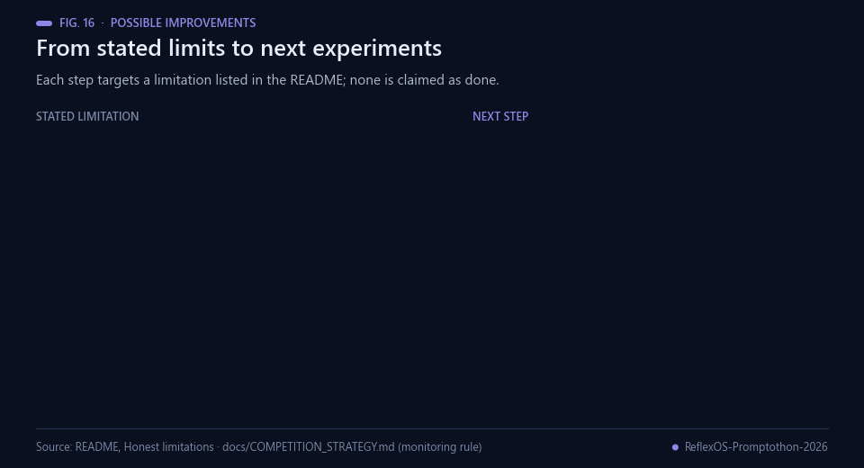<br><sub>Fig. 16 — Each improvement targets a limitation listed under Honest limitations.</sub></p>

- **Real-provider evaluation.** The benchmark is synthetic and isolates routing policy. A separate study of quality and
  cost with real models, on held-out tasks and with the routing policy frozen first, would test whether the simulated
  reductions carry over.
- **Stronger acceptance checks.** A simple string or JSON check does not prove factual truth. Task-specific checks, and
  a measurement of how often wrong answers pass them, would show how much the gates can be trusted [[7](#ref-7), [9](#ref-9)].
- **Documented live tiers.** The public prototype embeds no credentials and assumes no proprietary tier. A
  credential-separated test harness and documented adapters for real tiers would keep Luna-first and the budgets
  while making a live evaluation reproducible.
- **Comparison with public entries.** Public pages exposed no competitor writeups or notebooks. If public entries
  appear, compare only on documented architecture and measured evidence.

## Proposed next steps (not commitments)

<p align="center">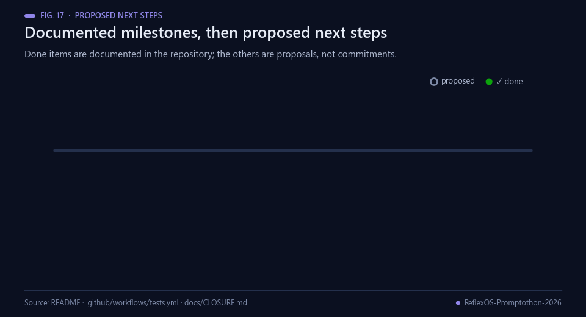<br><sub>Fig. 17 — Completed milestones are documented in this repository; the rest are proposals, not commitments.</sub></p>

Proposed next steps, in order; none is a commitment or claimed as started, and no new competition entry is being attempted:

1. Evaluate the routing policy with real providers, separately from the simulator.
2. Add stronger, task-specific acceptance checks and measure how often wrong answers pass them.
3. Add further typed deterministic tools behind the same Luna-first invariant.
4. Test a live TypeSafe JEV connector and report its contribution separately from the local fallback router.
5. Compare with public competitor entries only if such entries become public.

## Competition source

Promptothon 2026 official Kaggle page: <https://www.kaggle.com/competitions/promptothon-2026-ai-edition>

## License

MIT License. Copyright (c) 2026 Francisco Angulo de Lafuente.

## Bibliography

1. <a id="ref-1"></a>Chen, L., Zaharia, M., & Zou, J. (2023). FrugalGPT: How to Use Large Language Models While Reducing Cost and Improving Performance. *arXiv* 2305.05176. https://arxiv.org/abs/2305.05176
2. <a id="ref-2"></a>Ong, I., Almahairi, A., Wu, V., et al. (2024). RouteLLM: Learning to Route LLMs with Preference Data. *arXiv* 2406.18665. https://arxiv.org/abs/2406.18665
3. <a id="ref-3"></a>Ding, D., Mallick, A., Wang, C., et al. (2024). Hybrid LLM: Cost-Efficient and Quality-Aware Query Routing. *arXiv* 2404.14618. https://arxiv.org/abs/2404.14618
4. <a id="ref-4"></a>Dohan, D., Xu, W., Lewkowycz, A., et al. (2022). Language Model Cascades. *arXiv* 2207.10342. https://arxiv.org/abs/2207.10342
5. <a id="ref-5"></a>Gao, L., Madaan, A., Zhou, S., et al. (2022). PAL: Program-aided Language Models. *arXiv* 2211.10435. https://arxiv.org/abs/2211.10435
6. <a id="ref-6"></a>Schick, T., Dwivedi-Yu, J., Dessì, R., et al. (2023). Toolformer: Language Models Can Teach Themselves to Use Tools. *arXiv* 2302.04761. https://arxiv.org/abs/2302.04761
7. <a id="ref-7"></a>Cobbe, K., Kosaraju, V., Bavarian, M., et al. (2021). Training Verifiers to Solve Math Word Problems. *arXiv* 2110.14168. https://arxiv.org/abs/2110.14168
8. <a id="ref-8"></a>Lightman, H., Kosaraju, V., Burda, Y., et al. (2023). Let's Verify Step by Step. *arXiv* 2305.20050. https://arxiv.org/abs/2305.20050
9. <a id="ref-9"></a>Huang, J., Chen, X., Mishra, S., et al. (2023). Large Language Models Cannot Self-Correct Reasoning Yet. *arXiv* 2310.01798. https://arxiv.org/abs/2310.01798
10. <a id="ref-10"></a>Strubell, E., Ganesh, A., & McCallum, A. (2019). Energy and Policy Considerations for Deep Learning in NLP. *arXiv* 1906.02243. https://arxiv.org/abs/1906.02243
11. <a id="ref-11"></a>Schwartz, R., Dodge, J., Smith, N. A., & Etzioni, O. (2019). Green AI. *arXiv* 1907.10597. https://arxiv.org/abs/1907.10597
12. <a id="ref-12"></a>Abid, A., Abdalla, A., Abid, A., et al. (2019). Gradio: Hassle-Free Sharing and Testing of ML Models in the Wild. *arXiv* 1906.02569. https://arxiv.org/abs/1906.02569
13. <a id="ref-13"></a>Python Software Foundation. *ast — Abstract Syntax Trees*, Python 3 standard library documentation. https://docs.python.org/3/library/ast.html
14. <a id="ref-14"></a>Angulo de Lafuente, F. *Universal Cognitive Architecture JEV v2* (public repository). https://github.com/Agnuxo1/Universal-Cognitive-Architecture-JEV-v2
15. <a id="ref-15"></a>Angulo de Lafuente, F. *King-Skill: Extended Cognition Architecture for Scientific LLM Agents* (public repository). https://github.com/Agnuxo1/King-Skill-Extended-Cognition-Architecture-for-Scientific-LLM-Agents

---

<div align="center">
<sub>Built by <a href="https://github.com/Agnuxo1">Francisco Angulo de Lafuente</a> · every figure is an animated
rendering of the published file or offline run named in its footer · <a href="#reflexos--proof-carrying-adaptive-cognitive-routing">back to top ↑</a></sub>
</div>
